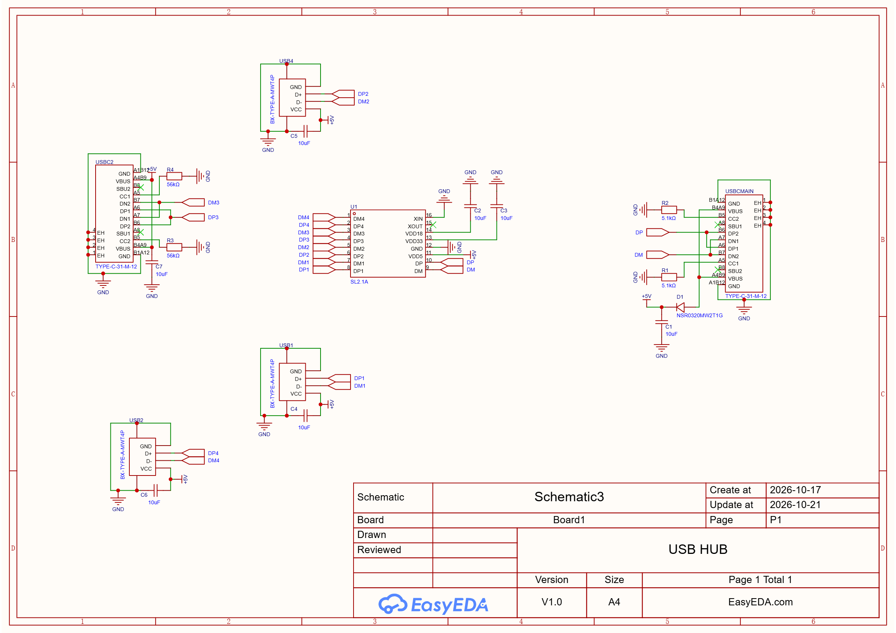

# USB-hub
**USB Hub – Product Description  Expand your connectivity instantly with this compact, plug-and-play USB hub. Designed for anyone who has ever run out of ports, it turns a single USB port into multiple, letting you connect your keyboard, mouse, and more all at once.**


##  Overview

**What is that?**

It’s a small gadget that gives your laptop more places to plug things in.

Most modern laptops only have one or two USB-C ports, which isn’t much if you want to use a mouse, a keyboard, and a flash drive at the same time. This hub plugs into one of those ports and gives you four new ones: three regular USB ports for your usual accessories, and one more USB-C port for newer devices.

## Cost JLCPCB

| Name          | Description                                                                   | Price  | Shipping |
| ------------- | ----------------------------------------------------------------------------- | ------ | -------- |
| Componenets   | Components from LCSC. Detailed breakdown [here](.BOM/export_cart_20261021_145739.csv) | $4.74  | $14.44   |
| PCB+Stencil   | PCB and stencil from JLC                                                      | $11,30 | $20,43   |
| **Sub Total** |                                                                               | $16.04 | $34.87   |
| **Total**     |                                                                               | $50.91 |          |


## Schematics

**This project was made on EasyEDA**





## Repo structure

```
├── EasyEDA/      EasyEDA file
├── BOM/          BOM file
├── Gerber/       Gerber file
├── PickAndPlace/ PickAndPlace file
├── schematics/   Schematic image
└── images/       photos and renders

```
